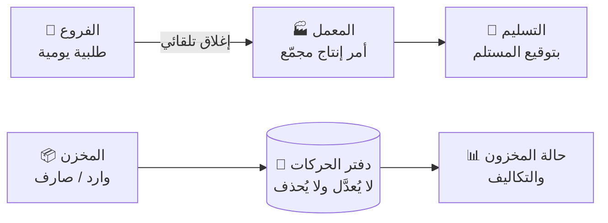

<div align="center">

# 🥐 نظام إدارة معامل المخابز

### Bakery Management System — الطلبيات والإنتاج والمخزون

**طلبيات الفروع اليومية ← أمر إنتاج مجمّع ← تسليم بتوقيع ← مخزون بدفتر حركات لا يُعدَّل**


[المزايا](#-المزايا) · [لقطات الشاشة](#-لقطات-الشاشة) · [البدء السريع](#-البدء-السريع) · [البنية](#️-بنية-المستودع) · [التوثيق](#-التوثيق)

</div>

---

## 💡 الفكرة

كان العميل يدير مخبزه بـ **شيت إكسل للطلبيات وقالبين للمخزون**. النظام يجمع هذا كله في **نظام تشغيلي واحد**: تطبيق ويب تقدّمي (PWA) عربي بالكامل يُثبَّت على الجوال والكمبيوتر، ويعمل حتى لو انقطع الإنترنت.



---

## ✨ المزايا

| | |
|---|---|
| 📱 **تطبيق حقيقي على الجوال** | PWA يُثبَّت بدون متجر، فيه شريط تنقل سفلي، وأهداف لمس 48dp، وهياكل تحميل بدل الدوّارات |
| 📶 **يعمل بدون اتصال** | الفرع يرسل طلبيته حتى لو انقطع الإنترنت (نمط Outbox)، وتتزامن عند رجوع الاتصال |
| ⏰ **نوافذ طلب وإغلاق تلقائي** | بتوقيت المنشأة، مع عدّاد للإغلاق وطلب تعديل بعد الإغلاق |
| 🏭 **أوامر إنتاج مجمّعة** | مصفوفة صنف × فرع بالإجماليات، والمسؤول، والوقت المتوقع، وقفل/بدء/إكمال |
| 📒 **مخزون بدفتر غير قابل للتعديل** | الرصيد يُحسب من مجموع الحركات، وإلغاء السند يتم بحركة عكسية، مع متوسط تكلفة مرجّح متحرك |
| 🖨️ **مطبوعات جاهزة** | أوامر إنتاج وأوراق تجهيز وإيصالات وسندات وتقارير مخزون (A4 وA5)، مع خيار خط كبير للعمال |
| 📤 **تصدير Excel** | من أي جدول، بورقة من اليمين لليسار (RTL) |
| 🔐 **صلاحيات حسب الدور** | تُفحص في الخادم لكل مسار، والتكاليف تُخفى عن من لا يملك صلاحية رؤيتها |
| 🏢 **متعدد المنشآت من البداية** | عزل كامل بين المنشآت (17/17 اختبار) |
| 🎨 **هوية قابلة للتخصيص** | الشعار والألوان، وثيمان مفحوص تباينهما حسب WCAG AA |

### 👥 ماذا يرى كل مستخدم

| الدور | النطاق | أهم الشاشات |
|---|---|---|
| **مستخدم الفرع** | طلبيته فقط | الرئيسية (عدّاد الإغلاق) · إدخال الطلبية بالأقسام الخمسة (المعجنات، المخبوزات، الكيك، البوتيفورات، الترت) · مراجعة وإرسال · السجل · الاستلام |
| **مدير المعمل** | كل الفروع | أوامر الإنتاج · المصفوفة · الاستثناءات · الطباعة · التسليم بتوقيع |
| **موظف المعمل** | الإنتاج والتسليم | نفس شاشات المعمل بدون قرارات الإدارة |
| **أمين المخزن** | المخزون والتكاليف | وارد/صارف سريع · بطاقة المادة · السندات · حالة المخزون (11 عموداً) · دفتر الحركة اليومية |
| **المالك / المدير** | كل شيء | لوحة المؤشرات · الإعدادات: الفروع، الأصناف، النوافذ، المستخدمون، الهوية، سجل النشاط |

---

## 📸 لقطات الشاشة

| الفرع — الرئيسية | إدخال الطلبية | مراجعة الطلبية |
|:---:|:---:|:---:|
|  |  |  |
| **المعمل — مصفوفة الإنتاج** | **المخزن — الرئيسية** | **حالة المخزون (11 عموداً)** |
|  |  |  |

<details>
<summary>🌙 الثيم الداكن «قهوة» ولقطات الكمبيوتر</summary>

| الفرع | المعمل | المخزن |
|:---:|:---:|:---:|
|  |  |  |

| لوحة المؤشرات (كمبيوتر) | الإنتاج (كمبيوتر) |
|:---:|:---:|
|  |  |

</details>

**الثيمات:** **رملي** فاتح (`#F4EFE6` + بني قهوة `#6B4F3A`) و**قهوة** داكن (`#191512` + كراميل `#C9A57A`). تبدّل بينها من «المزيد ← المظهر».

---

## 🚀 البدء السريع

**المتطلبات:** Node 20+ و pnpm 9

```bash
pnpm install
pnpm build                                   # يبني الواجهة إلى packages/web/dist
cd packages/server && ./scripts-restart.sh   # يصفّر D1 المحلية + الهجرات + wrangler dev على 8787 + البيانات الأولية
node scripts/demo-data.mjs                   # بيانات تجريبية: رصيد افتتاحي + وارد + صارف + طلبيتا فرعين
```

بعدها افتح `http://localhost:8787`.

إذا تبي تطوّر الواجهة مع إعادة تحميل فورية: `pnpm --filter @moain/web dev` (يشتغل على المنفذ 5173، ويحوّل طلبات `/api` إلى 8787).

### 🔑 حسابات التجربة

> [!WARNING]
> هذه الحسابات للعرض فقط وكلمة مرورها `123456`. **لازم تتعطل قبل التشغيل الفعلي** (انظر [قبل الإنتاج](#️-قبل-التشغيل-الفعلي)).

| الحساب | الدور |
|---|---|
| `owner@alnoor.ye` | المالك |
| `sitteen@alnoor.ye` · `hadda@alnoor.ye` | فرع الستين · فرع حدة |
| `plant@alnoor.ye` · `staff@alnoor.ye` | مدير المعمل · موظف المعمل |
| `store@alnoor.ye` | أمين المخزن |

### 🧪 الاختبارات

| المجموعة | الأمر | النتيجة |
|---|---|---|
| منطق النطاق (المال، الكميات، المتوسط المتحرك، آلات الحالة، الصلاحيات) | `pnpm --filter @moain/shared test` | 154 ✅ |
| المسار الكامل: طلبية ← إنتاج ← تسليم ← مخزون *(يحتاج الخادم شغّال)* | `cd packages/server && node test/e2e-api.mjs` | 45/45 ✅ |
| قيود قاعدة البيانات (الدفتر لا يُعدَّل، التسليم لا يُحذف…) | `./test/db-invariants.sh` | 12/12 ✅ |
| عزل المنشآت | `curl -X POST "localhost:8787/api/v1/dev/seed?slug=second" && node test/isolation.mjs` | 17/17 ✅ |

---

## 🧱 المكدس التقني

| الطبقة | التقنية |
|---|---|
| الواجهة | React 19 · TypeScript · Vite 6 · Tailwind 4 · TanStack Query · Zustand · vite-plugin-pwa |
| الخادم | Hono 4 على Cloudflare Workers |
| قاعدة البيانات | Cloudflare D1 (SQLite)، بمخطط متوافق مع Postgres وقيود سلامة داخل القاعدة عبر triggers |
| المصادقة | جلسات في D1 بكوكي HttpOnly + رمز PIN على الأجهزة الموثوقة · PBKDF2-SHA256 |
| الطباعة | HTML/CSS للطباعة من المتصفح («حفظ كـ PDF») |
| Excel | ExcelJS (يُحمَّل عند الطلب) |
| الخطوط | IBM Plex Sans Arabic (مستضافة ذاتياً) |

---

## 🏗️ بنية المستودع

```
packages/
├── shared/    منطق النطاق النقي بدون إطار: المال والكميات كأعداد صحيحة، المتوسط المرجّح المتحرك،
│              آلات الحالة، نوافذ الطلب بتوقيت المنشأة، الصلاحيات والتنقل لكل دور، مخططات Zod
├── server/    Hono على Cloudflare Workers + D1
│              src/modules/  auth · catalog · ordering · production · fulfillment · inventory · admin · reports · notify · seed
└── web/       React + PWA (Service Worker)
               src/screens/  branch · plant · store · admin  ·  src/print/  نماذج الطباعة  ·  src/ui/  المكونات
migrations/    هجرات D1: 0000 المخطط · 0001 قيود السلامة (ADR-0011) · 0002 المصادقة ومنع التكرار
docs/          الدراسة المعمارية (00–06) · قرارات adr/ · التنفيذ 07-implementation/
wrangler.toml  إعداد النشر من جذر المستودع
```

### 📐 مبادئ ما نكسرها

1. **الدفتر هو مصدر الحقيقة.** ما في عمود "كمية" يُكتب فيه مباشرة، والرصيد يُحسب من حركات ما تتعدّل ولا تنحذف.
2. **كل عملية حساسة ذرّية** (`db.batch`)، وتكرارها آمن (`client_uuid`).
3. **الصلاحيات تُفحص في الخادم** لكل مسار، والتكاليف تنحذف من الردود لمن ما عنده صلاحية.
4. **كل شيء يُهيّأ من الواجهة:** الفروع، والمعامل، والأصناف، والوحدات، وأوقات الإغلاق، والأدوار، والشعار.
5. **كل نص موجود في** `web/src/locales/ar.json`.

---

## 🌐 النشر

النظام منشور على **Cloudflare Workers + D1**. تفاصيل الإعداد والرابط المباشر في [`docs/07-implementation/deployment.md`](docs/07-implementation/deployment.md).

### ⚠️ قبل التشغيل الفعلي

- [ ] ضبط السر `PEPPER` **قبل** إنشاء أي مستخدم حقيقي
- [ ] تغيير `DEMO` إلى `"0"` (هذا يعطّل `/api/v1/dev/seed` وأزرار الدخول التجريبي)
- [ ] إنشاء منشأة العميل ومستخدميه الحقيقيين، وحذف الحسابات التجريبية

---

## 📋 خارطة الطريق

- [x] **M0:** الطلبيات، والإنتاج، والتسليم، والمخزون، والمطبوعات، وتصدير Excel، والعمل بدون اتصال
- [ ] تعديل وإيقاف المستخدمين والمواد والأصناف
- [ ] شاشة الجرد
- [ ] إشعارات Push
- [ ] تجهيز التشغيل الفعلي (تعطيل الحسابات التجريبية + ضبط `PEPPER`)

التفاصيل في [`docs/07-implementation/progress.md`](docs/07-implementation/progress.md) و [`docs/06-roadmap/00-phases.md`](docs/06-roadmap/00-phases.md).

---

## 📚 التوثيق

المشروع مبني على دراسة معمارية كاملة قبل كتابة الكود:

| القسم | المحتوى |
|---|---|
| 🎯 [`00-client-requests.md`](docs/00-client-requests.md) | طلبات العميل بنصها الحرفي + المبادئ الثمانية الحاكمة |
| 🔍 [`01-analysis/`](docs/01-analysis/) | [الملخص التنفيذي](docs/01-analysis/00-executive-summary.md) · [تحليل المتطلبات](docs/01-analysis/01-requirements-analysis.md) · [نتائج البحث](docs/01-analysis/02-research-findings.md) · [مصفوفة المرونة](docs/01-analysis/03-flexibility-matrix.md) |
| 🧩 [`02-domain/`](docs/02-domain/) | [القاموس الموحد](docs/02-domain/00-ubiquitous-language.md) · [السياقات](docs/02-domain/01-bounded-contexts.md) · [ERD](docs/02-domain/02-erd.md) · [آلات الحالة](docs/02-domain/03-state-machines.md) · [المخطط SQL](docs/02-domain/04-schema.sql) · [قواعد العمل](docs/02-domain/05-business-rules.md) |
| 🏛️ [`03-architecture/`](docs/03-architecture/) | [المعمارية](docs/03-architecture/00-system-architecture.md) · [عقد الـ API](docs/03-architecture/01-api-contract.md) · [العمل بدون اتصال](docs/03-architecture/02-offline-sync.md) · [الأمان والصلاحيات](docs/03-architecture/03-security-rbac.md) · [الطباعة والتصدير](docs/03-architecture/04-print-export.md) · [ميزانية الأداء](docs/03-architecture/05-performance-budget.md) |
| 🎨 [`04-design/`](docs/04-design/) | [نظام التصميم](docs/04-design/00-design-system.md) · [معايير تطبيق الجوال](docs/04-design/01-mobile-app-standards.md) · [خريطة الشاشات](docs/04-design/02-screen-map.md) · [الهياكل الشبكية](docs/04-design/03-wireframes.md) · [الهوية](docs/04-design/04-branding-whitelabel.md) |
| 🖨️ [`05-print-templates/`](docs/05-print-templates/) | نماذج طباعة HTML حقيقية + عينات PDF. افتح `index.html` ثم اضغط Ctrl+P |
| 🗺️ [`06-roadmap/`](docs/06-roadmap/00-phases.md) | المراحل والتسليمات ومعايير القبول |
| ⚙️ [`07-implementation/`](docs/07-implementation/) | فهم الوكيل المنفّذ، والتقدم، والنشر، والأدلة، ولقطات الشاشة |
| 📝 [`adr/`](docs/adr/) | 13 سجل قرار معماري (ADR) |
| 🤖 [`AGENT_PROMPT.md`](AGENT_PROMPT.md) | برومبت جاهز لأي وكيل أو مطوّر جديد يكمل على المشروع |

<details>
<summary>🖨️ معاينة نماذج الطباعة</summary>

| T1 — أمر إنتاج مجمّع (A4) | T3 — ورقة تجهيز لكل فرع (A5) |
|:---:|:---:|
|  |  |
| **T5 — سند توريد (A5)** | **T7 — حالة المخزون، 11 عموداً (A4 أفقي)** |
|  |  |

</details>

### القرارات الكبرى في سطر

| القرار | ليش |
|---|---|
| **PWA وليس تطبيق أصلي** | جهاز واحد لكل مستخدم، وما في متاجر، والتحديث فوري، والطباعة سهلة من الكمبيوتر |
| **Cloudflare Workers + D1** | خادم على الحافة (Edge) بتكلفة منخفضة وبدون إدارة خوادم ([ADR-0002](docs/adr/0002-hono-cloudflare-workers.md)، [ADR-0003](docs/adr/0003-d1-sqlite-drizzle.md)) |
| **دفتر حركات لا يُعدَّل** | تدقيق كامل ورصيد ما يمكن يتلاعب فيه أحد ([ADR-0008](docs/adr/0008-ledger-immutable.md)) |
| **Offline-first بنمط Outbox** | الإنترنت في الفروع ما يكون دائماً مستقر ([ADR-0005](docs/adr/0005-offline-outbox.md)) |
| **Excel كميزة ثانوية** | نعطي العميل اللي طلبه بالحرف، بس النظام نفسه ما يعتمد على Excel |

---

<div align="center">

صُنع لمعامل المخابز 🍞 · واجهة عربية بالكامل ومن اليمين لليسار

</div>
